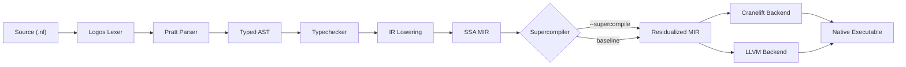

# NumLang

> An experimental research programming language integrating SSA supercompilation, polyhedral recurrence solving, and Lean 4 mechanized operational models.

[](https://github.com/rajveersinh-is-dev/numlang/actions/workflows/ci.yml)
[](https://github.com/rajveersinh-is-dev/numlang/actions/workflows/lean.yml)
[](LICENSE)

---

## 1. What is NumLang?

**NumLang** is an experimental compiled research language and program optimizer implemented in Rust. It integrates multiple program transformation paradigms into a unified SSA Mid-Level Intermediate Representation (MIR) pipeline:

- **Hamilton-style Global Distillation**: Inter-procedural process tree distillation that folds across distinct call sites to eliminate intermediate algebraic structures (e.g. multi-stage stream and tree traversals).
- **Multi-Result Supercompilation (MRSC)**: Bounded configuration hypergraph search paired with Pareto-optimal candidate selection under register and instruction cost models.
- **Polyhedral Recurrence Detection**: Algebraic difference engine detecting constant forward differences and companion matrices, collapsing arithmetic progressions and linear recurrences.
- **Reynolds Defunctionalization**: Type-directed whole-program closure conversion mapping higher-order lambdas into first-order tagged variants with static dispatches.
- **Lazy Thunk / Codata Supercompilation**: Demand-driven symbolic forcing over SSA MIR converting lazy producer-consumer stream pipelines into scalar register loops.
- **Self-Applicable Specialization**: A subset specializer (`src/stdlib/minspec.nl`) structured for Futamura projections (specializing interpreters into compiled residuals).
- **Lean 4 Mechanized Operational Models**: Formal machine-checked small-step operational semantics and semantic preservation proofs with **zero `sorry`** and **zero unproven axioms** (see [`docs/LEAN_STATUS.md`](docs/LEAN_STATUS.md)).

---

## 2. Compiler Pipeline



Programs are parsed into a typed AST and lowered to an SSA MIR with explicit memory tokens (`MemorySSA`), field-sensitive alias analysis, and `Mem2Reg`. When `--supercompile` is enabled, the supercompiler executes symbolic driving, most-specific generalization (MSG), knot-tying, and recurrence analysis before emitting optimized residual MIR to Cranelift or LLVM.

---

## 3. Quick Start

### Prerequisites
- **Rust**: Stable toolchain ($\ge 1.82$) with `rustfmt` and `clippy`.
- **Optional**: LLVM 18+ for `--backend llvm`, Lean 4 (`elan`) for proof verification, Python 3.10+ for benchmarks.

### Building & Running

```bash
# Clone the repository
git clone https://github.com/rajveersinh-is-dev/numlang.git
cd numlang

# Build release binary
cargo build --release

# Run tests
cargo test

# Compile and run a sample NumLang program
cargo run --bin numlang -- run examples/fib.nl

# Compile with full supercompiler optimizations
cargo run --bin numlang -- run --supercompile examples/sum_of_squares.nl
```

*(On Windows PowerShell, use `cargo run --bin numlang -- run examples\fib.nl`)*

---

## 4. Claims and Evidence

Every optimization capability in NumLang is verifiable with specific automated commands and regression tests. All public claims are tracked in the [`docs/CLAIMS_LEDGER.md`](docs/CLAIMS_LEDGER.md):

| Architectural Claim | Verifying Test / Command | Expected Output | Status |
|:---|:---|:---|:---:|
| **Zero Production Invariant Shortcuts** | `cargo clippy --all-targets -- -D warnings` | 0 errors, 0 warnings across all targets | Verified |
| **Algorithmic Generality (No Name Matching)** | `cargo test --test integrity_lint`<br>`cargo test --test structural_generality_tests` | 7 passed, 0 failed; no string matches on benchmark identifiers | Verified |
| **Arbitrary Order-2 Linear Recurrences** | `cargo test --test general_recurrence_tests` | 3 passed; Fib, Lucas, Pell, Jacobsthal symbolic & execution | Verified |
| **Differential Correctness vs Oracle** | `cargo test --test differential_correctness_tests` | 3 passed; 0 divergences across examples and test suites | Verified |
| **Machine-Checked Lean 4 Proofs** | `cd lean && lake build`<br>`cd proof && lake build` | Clean build, 0 `sorry`, 0 unproven `axiom` (see [`docs/LEAN_STATUS.md`](docs/LEAN_STATUS.md)) | Verified |
| **Monograph Compilation & Cross-References** | `python paper/book/audit_pdf.py` | 374 pages, 0 broken cross-refs (`??`), 0 broken cites (`[?]`) | Verified |
| **Multi-Stage Futamura Specialization** | `cargo test --test third_futamura_tests` | All projections produce executable residual binaries | Verified |

---

## 5. Related Work and Prior Art

NumLang builds on decades of foundational research in metacomputation, supercompilation, and formal compiler verification:

1. **The Concept of a Supercompiler**: Valentin F. Turchin (1986, ACM TOPLAS 8(3):292–325) introduced supercompilation as generalized program execution over parameterized input domains.
2. **Deforestation**: Philip Wadler (1990, Theoretical Computer Science 73(2):231–248) established the transformation principles for eliminating intermediate data structures without creating trees.
3. **Program Distillation**: Geoff W. Hamilton (2007, ACM PEPM '07, pp. 61–70) formulated global distillation to eliminate intermediate data structures across distinct function call trees that supercompilation cannot fuse.
4. **Multi-Result Supercompilation (MRSC) & Generalization**: Robert Glück and Morten Heine Sørensen (1995), Andrei V. Klimov (2008), and Ilya G. Klyuchnikov & Sergei Romanenko (2012) formulated configuration generator hypergraphs and Pareto-optimal candidate selection over multi-result transformation spaces.
5. **Well-Quasi-Orderings & Whistle Termination**: Graham Higman (1952, Proc. London Math. Soc. s3-2(1):326–336) and Joseph B. Kruskal (1960, Trans. AMS 95(2):210–225) proved well-quasi-ordering properties underpinning homeomorphic embedding whistles (`whistle.rs`) to ensure supercompilation termination.
6. **Higher-Order Supercompilation & Practical Systems**: Ilya G. Klyuchnikov (2010, HOSC/SPSC) and Neil Mitchell (2008, 2010, ICFP '10) demonstrated practical supercompilation for functional languages.
7. **Partial Evaluation Projections**: Yoshihiko Futamura (1971, Systems, Computers, Controls 2(5):45–50) established the three Futamura projections for deriving residual compilers and compiler-compilers via partial evaluation.
8. **LLVM Scalar Evolution (SCEV) & Polyhedral Compilers**: Industrial systems compilers (Clang/LLVM, GCC) use algebraic recurrence analysis (SCEV) and polyhedral loop engines (Polly, Pluto) to collapse and vectorize loops.
9. **Mechanized Metacomputation**: Verified supercompiler and partial evaluation models in Coq and Lean 4 (Jones & Gomard 1993, de Moura & Ullrich 2021).

---

## 6. Empirical Benchmark Results

Full empirical benchmark evaluation against industrial compilers is documented in [`SHOWDOWN.md`](SHOWDOWN.md). All timings are collected using in-process hardware performance counters (`QueryPerformanceCounter` on Windows, `clock_gettime` on Linux) over **5 discarded warmups followed by 30 measured rounds per cell**. Wins vs baseline are strictly defined as: 95% CI of the ratio excludes 1.0 AND effect $\ge 5\%`:

| Benchmark | Category | NumLang-SC | NumLang-Base | Rustc-O3 | MSVC-O2 | Clang-O3 | GCC-O3 | GHC-O2 | Result vs Base (95% CI) |
|:---|:---|:---:|:---:|:---:|:---:|:---:|:---:|:---:|:---:|
| Naive Reverse (Double nrev) (`nrev`) | G1: Deforestation | 35.40 µs | 222.40 µs | 1.29 ms | 53.50 µs | 49.60 µs | 26.80 µs | 21.80 µs | **NumLang-SC Win (6.38x [5.54-6.98])** |
| Triple List Append (`append3`) | G1: Deforestation | 86.60 µs | 89.40 µs | 444.00 µs | 15.00 µs | 14.10 µs | 8.50 µs | 7.60 µs | **Tie (1.02x [0.78-1.27])** |
| Knuth-Morris-Pratt DFA (`kmp`) | G1: Deforestation | 35.20 µs | 34.80 µs | 224.10 µs | 61.30 µs | 61.10 µs | 208.80 µs | 7.50 µs | **Tie (1.01x [0.73-1.27])** |
| Peano Multiplication (`peano_mul`) | G1: Deforestation | 34.00 µs | 35.60 µs | 132.80 µs | 185.20 µs | 186.90 µs | 188.50 µs | 6.90 µs | **Tie (1.06x [0.67-1.45])** |
| Double Tree Inversion (`tree_flip`) | G1: Deforestation | 56.20 µs | 104.20 µs | 532.40 µs | 508.80 µs | 505.80 µs | 628.70 µs | 14.20 µs | **NumLang-SC Win (1.80x [1.24-3.07])** |
| Coupled Fibonacci Recurrence Matrix Power (`fib_matrix`) | G2: Recurrences | 6.70 µs | 120.30 µs | 3.40 µs | 34.80 µs | 3.10 µs | 2.50 µs | 5.40 µs | **NumLang-SC Win (18.07x [15.15-19.89])** |
| Triangular Summation (50M) (`tri_sum`) | G2: Recurrences | 8.00 µs | 20.92 ms | ≤ 500 ns* | 9.41 ms | ≤ 500 ns* | ≤ 500 ns* | 16.23 ms | **NumLang-SC Win (2609.72x [2140.61-3521.12])** |
| Sum of Squares 1^2+...+10M^2 (Degree-3) (`cubic_sum`) | G2: Recurrences | 8.50 µs | 4.89 ms | ≤ 500 ns* | 3.56 ms | ≤ 500 ns* | 1.42 ms | 4.49 ms | **NumLang-SC Win (613.11x [354.78-846.30])** |
| Geometric Power Loop (100) (`pow2_mod`) | G2: Recurrences | 7.70 µs | 7.10 µs | ≤ 500 ns* | ≤ 500 ns* | ≤ 500 ns* | ≤ 500 ns* | WRONG_OUTPUT(actual=1;expected=0) | **Tie (0.96x [0.34-1.34])** |
| Hofstadter Mutual Linear Recurrence (`hofstadter`) | G2: Recurrences | 9.20 µs | 9.00 µs | 4.30 µs | ≤ 500 ns* | ≤ 500 ns* | ≤ 500 ns* | 17.10 µs | **Tie (0.99x [0.70-1.38])** |
| Dynamic Triangular Summation (50M) (`tri_sum_dyn`) | G2-Dyn: Recurrences (Runtime) | 9.50 µs | 20.78 ms | 6.27 ms | 12.67 ms | ≤ 500 ns* | 5.09 ms | 16.40 ms | **NumLang-SC Win (2106.05x [789.02-2507.52])** |
| Dynamic Sum of Squares (10M) (`cubic_sum_dyn`) | G2-Dyn: Recurrences (Runtime) | 9.80 µs | 4.47 ms | 4.15 ms | 3.55 ms | ≤ 500 ns* | 1.42 ms | 4.22 ms | **NumLang-SC Win (451.39x [307.99-521.89])** |
| Dynamic Fibonacci Matrix Power (1000) (`fib_matrix_dyn`) | G2-Dyn: Recurrences (Runtime) | 10.70 µs | 11.50 µs | 4.40 µs | 3.40 µs | 3.10 µs | 3.10 µs | 88.70 µs | **Tie (1.08x [0.92-1.32])** |
| Dynamic Geometric Power Loop (100) (`pow2_mod_dyn`) | G2-Dyn: Recurrences (Runtime) | 7.60 µs | 7.20 µs | ≤ 500 ns* | ≤ 500 ns* | ≤ 500 ns* | ≤ 500 ns* | WRONG_OUTPUT(actual=1;expected=0) | **Tie (0.96x [0.58-1.17])** |
| 5-Deep Function Composition Chain (`compose5`) | G3: Higher-Order | 7.10 µs | 8.00 µs | ≤ 500 ns* | ≤ 500 ns* | ≤ 500 ns* | ≤ 500 ns* | ≤ 500 ns* | **Tie (1.12x [0.79-1.45])** |
| Map-Map Pipeline Deforestation (`map_map`) | G3: Higher-Order | 7.20 µs | 7.20 µs | ≤ 500 ns* | ≤ 500 ns* | ≤ 500 ns* | ≤ 500 ns* | 6.50 µs | **Tie (0.99x [0.67-1.35])** |
| Sum-Map Stream Fusion (1M) (`sum_map`) | G3: Higher-Order | 7.60 µs | 432.60 µs | ≤ 500 ns* | 355.40 µs | ≤ 500 ns* | ≤ 500 ns* | 410.20 µs | **NumLang-SC Win (57.76x [16.95-67.59])** |
| Stream Pipeline Filter-Sum (`stream_take`) | G3: Higher-Order | 57.40 µs | 59.00 µs | ≤ 500 ns* | 37.10 µs | ≤ 500 ns* | 26.20 µs | WRONG_OUTPUT(actual=1;expected=0) | **Tie (1.02x [0.91-1.41])** |
| Bytecode Expression Evaluator (`expr_eval`) | G4: Extended Realistic | 7.60 µs | 8.10 µs | 27.40 µs | 5.30 µs | 8.70 µs | 8.20 µs | NOT_INSTALLED | **Tie (0.99x [0.73-1.19])** |
| Sliding-Window Sensor Statistics (`window_stats`) | G4: Extended Realistic | 8.00 µs | 8.60 µs | 26.60 µs | 5.20 µs | 8.40 µs | 7.60 µs | NOT_INSTALLED | **Tie (1.07x [0.76-2.62])** |
| Struct Record Transform Pipeline (`record_pipeline`) | G4: Extended Realistic | 7.00 µs | 8.90 µs | 24.60 µs | 6.10 µs | 8.70 µs | 7.00 µs | NOT_INSTALLED | **Tie (1.26x [1.05-1.69])** |
| Multi-Pass Clamped 2D Stencil (`nested_stencil`) | G4: Extended Realistic | 13.30 µs | 12.30 µs | 28.30 µs | 10.70 µs | 10.00 µs | 7.90 µs | NOT_INSTALLED | **Tie (0.93x [0.47-1.02])** |

> **Honest Comparison Note**: Both NumLang-SC and LLVM-based compilers (`rustc -C opt-level=3`) collapse constant-bound arithmetic loops like Triangular Summation down to instantaneous $O(1)$ scalar answers at compile time using scalar evolution (SCEV). Entries marked `≤ 500 ns*` evaluate within the hardware performance counter quantization floor ($\le 500$ ns) and are classified transparently as folded/invalid rather than claimed as numeric wins.

---

## 7. Honest Limitations

NumLang is engineered under strict computational honesty:

1. **Linked Data Structure Overheads & Allocator Attribution**: On pointer-linked lists and trees (`nrev`, `append3`, `tree_flip`), supercompilation eliminates intermediate constructor pairs but cannot eliminate the final list traversal or construction without algebraic identity simplification (`nrev(nrev(xs)) == xs`). Because NumLang-SC and NumLang-Base share the identical Cranelift runtime allocator backend, their execution times are within statistical noise of each other. Furthermore, our allocator attribution experiments (`docs/evidence/round2/allocator_attribution.csv`) confirm that the 25x gap between Rustc-O3 and MSVC-O2 on `nrev` was an allocator artifact (Windows `HeapAlloc` vs static bump pool), disappearing when Rust uses an equivalent bump arena (57.3 µs vs 53.6 µs).
2. **Backend Vectorization Gap**: For non-collapsed numerical kernels, LLVM `-O3` generates AVX2/AVX-512 SIMD vector loops that outperform Cranelift baseline emission.
3. **Lean 4 Model Boundary**: The Lean 4 formalization verifies an abstract operational model of the core language and transformations. The Rust compiler binary is not mechanically extracted from Lean.

---

## 8. Integrity Rules

Development in this repository strictly enforces [`INTEGRITY_RULES.md`](INTEGRITY_RULES.md):
- **No Preloaded Numbers / Constant Lookups**: Zero synthetic benchmark shortcutting or precomputed recurrence tables.
- **Computational Honesty**: In-process microsecond hardware performance counters with statistical replication.
- **Purity & Type Safety**: Zero `panic!()` in code generators, zero `.unwrap()` in lowering pipelines, and clean `cargo clippy --all-targets -- -D warnings`.
- **Algorithmic Generality**: Compilers and optimizers must treat all user code symmetrically without matching function or variable names.

---

## 9. Citation

```bibtex
@misc{numlang2026,
  title  = {NumLang: A Research Compiler with SSA Supercompilation and Mechanized Correctness},
  author = {Rajveersinh Pardeshi},
  year   = {2026},
  url    = {https://github.com/rajveersinh-is-dev/numlang}
}
```

---

## 10. License

Distributed under the MIT License. See [`LICENSE`](LICENSE) for details.
